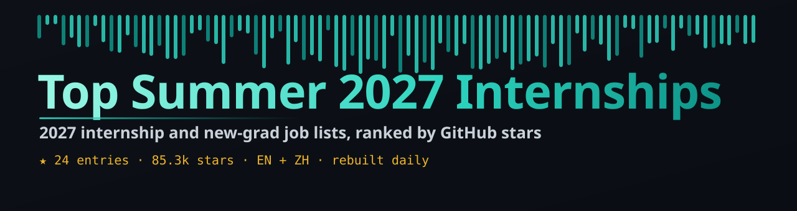

# 2027 暑期实习大集结

<i>2027 暑期实习与应届生岗位清单合集，按 GitHub Stars 排名</i>

  

  

[English](README.md) · **简体中文**

---

## 目录

- [🏆 精选 Top](#top-picks)
- [Internship Lists](#sec-1) · 12
- [New Grad & Early Career](#sec-2) · 12
- [📖 关于本列表](#about)

## 🏆 精选 Top

| # | 项目 | ⭐ Stars | 语言 | 更新 | 简介 |
|:-:|:--|--:|:-:|:-:|:--|
| 1 | [**SimplifyJobs/Summer2027-Internships**](https://github.com/SimplifyJobs/Summer2027-Internships) | 48.2k | Python | 2026-10-30 | Summer 2027 software engineering, data science, AI, quant, product management, and hardware internship postin… |
| 2 | [**speedyapply/2027-SWE-College-Jobs**](https://github.com/speedyapply/2027-SWE-College-Jobs) | 9.6k | — | 2026-10-29 | 2027 SWE internship & new graduate job list updated daily |
| 3 | [**vanshb03/Summer2027-Internships**](https://github.com/vanshb03/Summer2027-Internships) | 9.2k | — | 2026-10-30 | Collection of Summer, Fall, Spring 2027 tech internships! |
| 4 | [**speedyapply/2027-AI-College-Jobs**](https://github.com/speedyapply/2027-AI-College-Jobs) | 6.6k | — | 2026-10-29 | 2027 AI/ML internship & new graduate job list updated daily |
| 5 | [**zapplyjobs/Internships-2027**](https://github.com/zapplyjobs/Internships-2027) | 5.2k | HTML | 2026-10-30 | 2027 tech & software engineering internships for students — new grad US roles, summer & full-year |

## Internship Lists

| # | 项目 | ⭐ Stars | 语言 | 更新 | 简介 |
|:-:|:--|--:|:-:|:-:|:--|
| 1 | [**SimplifyJobs/Summer2027-Internships**](https://github.com/SimplifyJobs/Summer2027-Internships) | 48.2k | Python | 2026-10-30 | Summer 2027 software engineering, data science, AI, quant, product management, and hardware internship postin… |
| 2 | [**speedyapply/2027-SWE-College-Jobs**](https://github.com/speedyapply/2027-SWE-College-Jobs) | 9.6k | — | 2026-10-29 | 2027 SWE internship & new graduate job list updated daily |
| 3 | [**vanshb03/Summer2027-Internships**](https://github.com/vanshb03/Summer2027-Internships) | 9.2k | — | 2026-10-30 | Collection of Summer, Fall, Spring 2027 tech internships! |
| 4 | [**speedyapply/2027-AI-College-Jobs**](https://github.com/speedyapply/2027-AI-College-Jobs) | 6.6k | — | 2026-10-29 | 2027 AI/ML internship & new graduate job list updated daily |
| 5 | [**zapplyjobs/Internships-2027**](https://github.com/zapplyjobs/Internships-2027) | 5.2k | HTML | 2026-10-30 | 2027 tech & software engineering internships for students — new grad US roles, summer & full-year |
| 6 | [**negarprh/Canadian-Tech-Internships-2027**](https://github.com/negarprh/Canadian-Tech-Internships-2027) | 1.3k | — | 2026-10-29 | A curated, regularly updated list of Canadian tech internships for Summer, Fall, and Winter 2027. Includes co… |
| 7 | [**zshah101/Automated-List-Of-Summer-2027-and-Fall-2026-Tech-I…**](https://github.com/zshah101/Automated-List-Of-Summer-2027-and-Fall-2026-Tech-Internships) | 954 | Python | 2026-10-30 | Tech internships & CS jobs tracker - 180 open software engineering internships from 4,300 employer job boards… |
| 8 | [**sndsh404/summer-2027-internships**](https://github.com/sndsh404/summer-2027-internships) | 938 | — | 2026-08-03 | Summer 2027 and off-season tech internships in the US. Software, data and ML, hardware, quant, and product ro… |
| 9 | [**zapplyjobs/awesome-ml-internships-2027**](https://github.com/zapplyjobs/awesome-ml-internships-2027) | 463 | — | 2026-10-30 | Live AI and machine learning internships for students, refreshed through the Zapply job pipeline. |
| 10 | [**dreamworkhq/Tech-Internships-2027**](https://github.com/dreamworkhq/Tech-Internships-2027) | 151 | — | 2026-10-29 | 2026–2027 tech internships in the US, updated daily. Software engineering, data science, security, product, a… |

展开其余 2 项

| # | 项目 | ⭐ Stars | 语言 | 更新 | 简介 |
|:-:|:--|--:|:-:|:-:|:--|
| 11 | [**DereC4/internships-and-newgrad**](https://github.com/DereC4/internships-and-newgrad) | 131 | Go | 2026-10-30 | I used this during college, to save time, so maybe it will help you too! My own aggregated, deduplicated list… |
| 12 | [**resumax/tech-internships**](https://github.com/resumax/tech-internships) | 109 | — | 2026-10-29 | Open software, data, AI, ML, security, and hardware internships for Summer 2026 and 2027, updated daily. Tail… |

## New Grad & Early Career

| # | 项目 | ⭐ Stars | 语言 | 更新 | 简介 |
|:-:|:--|--:|:-:|:-:|:--|
| 1 | [**zapplyjobs/New-Grad-Jobs-2027**](https://github.com/zapplyjobs/New-Grad-Jobs-2027) | 1.6k | HTML | 2026-10-30 | 2027 entry-level jobs in tech, finance, healthcare & more — new grad US roles across software, business, oper… |
| 2 | [**zapplyjobs/New-Grad-Data-Science-Jobs-2027**](https://github.com/zapplyjobs/New-Grad-Data-Science-Jobs-2027) | 88 | HTML | 2026-10-30 | 2027 entry-level data science & ML jobs — analytics, AI, quant & machine learning US roles |
| 3 | [**zapplyjobs/New-Grad-Software-Engineering-Jobs-2027**](https://github.com/zapplyjobs/New-Grad-Software-Engineering-Jobs-2027) | 76 | HTML | 2026-10-30 | 2027 entry-level software engineering jobs — SWE & full-time US roles from top tech companies & startups |
| 4 | [**zapplyjobs/New-Grad-Hardware-Engineering-Jobs-2027**](https://github.com/zapplyjobs/New-Grad-Hardware-Engineering-Jobs-2027) | 68 | HTML | 2026-10-30 | 2027 entry-level hardware engineering jobs — EE, embedded systems & robotics US roles |
| 5 | [**SuryaHarikrishnan/2027-internship-tracker**](https://github.com/SuryaHarikrishnan/2027-internship-tracker) | 55 | Python | 2026-10-30 | Daily-updated, deduplicated Summer 2026 & Summer 2027 internships and new grad SWE/AI/Data jobs tracker, aggr… |
| 6 | [**simonesiega/european-tech-opportunities-2027**](https://github.com/simonesiega/european-tech-opportunities-2027) | 43 | Python | 2026-10-29 | Your open-source hub for 2027 tech internships and New Grad opportunities across Europe. |
| 7 | [**ApplyGuy/2027-New-Grad-Jobs**](https://github.com/ApplyGuy/2027-New-Grad-Jobs) | 34 | — | 2026-10-30 | Verified 2027 new grad and entry-level software engineering jobs, updated automatically from employer career… |
| 8 | [**aprameyak/2027-tech-jobs**](https://github.com/aprameyak/2027-tech-jobs) | 30 | TypeScript | 2026-10-29 | Frequently updated tech jobs repo for internships, off-cycle postings, and new grads |
| 9 | [**zapplyjobs/New-Grad-Healthcare-Jobs-2027**](https://github.com/zapplyjobs/New-Grad-Healthcare-Jobs-2027) | 16 | HTML | 2026-10-30 | 2027 entry-level healthcare jobs — nursing, allied health & clinical US roles |
| 10 | [**zapplyjobs/Canada-Internships-2027**](https://github.com/zapplyjobs/Canada-Internships-2027) | 14 | — | 2026-10-30 | Internships and co-ops across Canada for students, sourced live and updated in real time. |

展开其余 2 项

| # | 项目 | ⭐ Stars | 语言 | 更新 | 简介 |
|:-:|:--|--:|:-:|:-:|:--|
| 11 | [**Donkey0322/JobRadar-AI**](https://github.com/Donkey0322/JobRadar-AI) | 13 | TypeScript | 2026-10-30 | AI-powered tech opportunity tracker for all levels: 2027 summer internships, new grad, entry-level, mid-level… |
| 12 | [**HackedRico/2027-cyber-jobs**](https://github.com/HackedRico/2027-cyber-jobs) | 13 | CSS | 2026-10-30 | Cybersecurity 2027 - Internships, New Grads, and Early Career |

## 📖 关于本列表

本列表从 GitHub 自动采集，经过去重、链接检查，按 Stars 排名（Stars 相同时按最近更新排序），并定时自动刷新，数据始终保持最新。

---

自动生成 · 定时刷新 · 按 GitHub Stars 排名 · 2026-10-30

